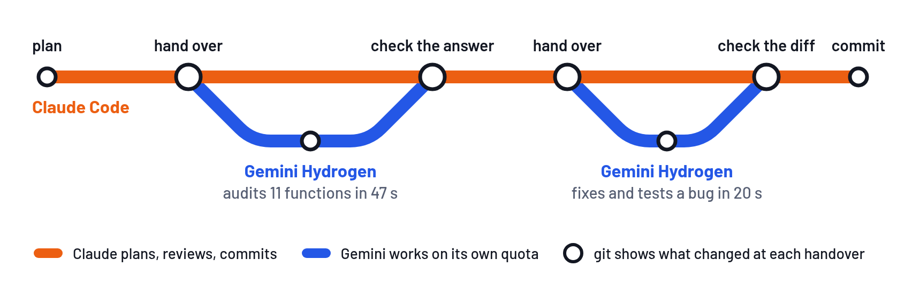
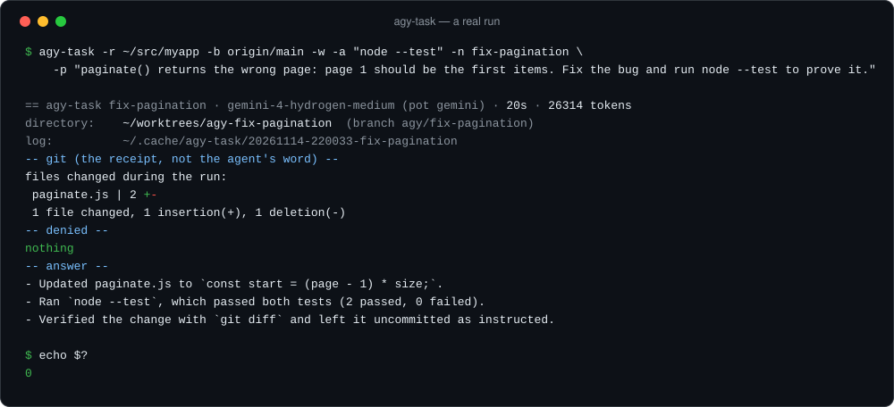

<h1 align="center">agy-task</h1>

<p align="center">
  <strong>Claude plans. Gemini does the legwork.</strong>
</p>

<p align="center">
  agy-task lets Claude Code hand tasks to Google's <a href="https://antigravity.google.com">Antigravity</a> models.<br>
  Two AI providers in one workflow, and git shows what changed at every handover.
</p>

<p align="center">
  
  
  
  
</p>

<p align="center">
  <picture>
    <source media="(prefers-color-scheme: dark)" srcset="assets/workflow-dark.png">
    
  </picture>
</p>
<p align="center">
  <sub>Both tasks on the map are real runs, timed on Gemini 4 Hydrogen.</sub>
</p>

## Why two AI providers in one workflow

**Each model does what it is good at.** Claude Code keeps the thread. It plans the change, writes
the handover, checks what comes back and commits. Gemini takes the legwork: searching a codebase,
asking one question of fifty files, running the test suite, a small bounded fix. The two tasks on
the map took it 47 and 20 seconds.

**The legwork runs on a second quota.** Antigravity's models have a quota of their own, so searches
and test runs stop spending the tokens you want Claude to think with. Over one day of use, Gemini
Hydrogen cost about 0.25 % of its weekly quota per 100k tokens.

**You get a second opinion from another lab.** A different model misses different things. Claude
wrote agy-task, Gemini and Claude models reviewed it through agy-task, and each found bugs the
others had missed ([numbers](#numbers)).

**git keeps both honest.** An agent's "done" is a claim, whichever lab trained it. This is a real
answer from `agy -p`, after a run that used 129k tokens (other fields left out):

```json
{
  "status": "SUCCESS",
  "response": "",
  "denied_actions": [{"action": "read_file", "display_name": "ReadFile"}]
}
```

A tool call was denied and the response is empty, yet the status says `SUCCESS`. agy-task exits 4
on that, names what was denied, and prints what git says changed. That is the one account you can
check.

**The agent stays in its lane, within limits.** Every task gets a fresh worktree at the ref you
name. Shell commands are denied unless you allowed them by prefix, and that includes `git commit`
and `git push`. A read task denies every file write and runs in agy's terminal sandbox, and the
commands it may run by default can neither write a file nor start a program. A write task's
commands run outside that sandbox, with the whole filesystem and the network, and the git receipt
covers the worktree only ([trap 12](#twelve-things-agy--p-will-not-tell-you)).

**You can read it before you run it.** Two bash scripts, built on git, jq and standard Linux
tools: `agy-task` (about 750 lines) runs one task, and `agy-review` (about 340) runs a review as
several agy-task runs.

> [!WARNING]
> **Your code is sent to Google.** Everything the agent reads goes to the model you pick. Do not
> point it at secrets, `.env` files, production data or anything you would not paste into a chat.
> A fresh worktree has no untracked files, which helps. It does not make an unsuitable repository
> suitable.

**Contents:** [Try it](#try-it-in-a-minute) ·
[A handover](#what-a-handover-looks-like) ·
[Exit codes](#when-something-goes-wrong-it-says-so) ·
[The workflow](#the-workflow-stop-by-stop) ·
[Numbers](#numbers) ·
[Reviews](#reviews-a-fleet-of-narrow-lenses) ·
[Quotas and budgets](#quotas-and-budgets) ·
[The twelve traps](#twelve-things-agy--p-will-not-tell-you) ·
[Reference](#reference) ·
[FAQ](#faq)

## Try it in a minute

You need `agy` installed and signed in.

### From Claude Code

```
/plugin marketplace add kanylbullen/agy-task
/plugin install agy-task@agy-task
```

Then say "offload this to agy", or let Claude decide when a job fits. The plugin ships the script
and a short [skill](skills/agy-task/SKILL.md) that teaches Claude:

- **when to hand over:** mechanical work with an answer that can be checked, such as a codebase
  search, the same question asked of many files, a test run, or a bounded fix with a test command
- **when not to:** secrets, production data, access control, payments, and design decisions
- **how to hand over:** the agent starts cold, so the prompt carries the goal, the files already
  found, the trap, the test command and what done looks like
- **what to trust:** the exit code and the git receipt, read before anything is reported as done

The skill is about 130 lines. Read it before you install the plugin.

`/plugin marketplace update agy-task` fetches a newer version, and
`/plugin uninstall agy-task@agy-task` removes it.

### From your shell

```sh
for f in agy-task agy-review; do
  curl -fsSL "https://raw.githubusercontent.com/kanylbullen/agy-task/main/bin/$f" -o ~/.local/bin/$f.new &&
    chmod +x ~/.local/bin/$f.new && mv ~/.local/bin/$f.new ~/.local/bin/$f
done
```

The same loop updates an installed copy. It downloads beside the old file and moves the new one
over it, so a job that is running keeps reading the version it started with
([why](#twelve-things-agy--p-will-not-tell-you)). To uninstall, delete the two files;
`~/.cache/agy-task` and `~/.config/agy-task` hold the logs, the ledger and your settings.

**Check what you have left.** `agy-task -q` shows what remains of each Antigravity limit and when it
refills, without spending tokens.

**Start with a question.** In any git repository:

```sh
agy-task -C . -p "Which source files have no tests? List them, most important first."
```

This is a read task: every file write is denied and only read-only commands are allowed, so the
worst outcome is a wrong answer.

**Then let it change something:**

```sh
agy-task -r ~/src/myapp -b origin/main -w -a "npm test" -n fix-pagination \
  -p "paginate() returns the wrong page for page 1. Fix it and run npm test."
```

That fetches `origin`, creates the branch `agy/fix-pagination` in `~/worktrees/agy-fix-pagination`,
and lets the agent edit files there and run `npm test`, but no other command. The work happens in
the worktree, not in your checkout, and nothing is committed. You read the diff, then commit and
push it yourself.

## What a handover looks like

<p align="center">
  
</p>
<p align="center">
  <sub>The second task on the map, as it ran: bug found, fixed and tested in 20 seconds. Paths shortened, answer trimmed.</sub>
</p>

## When something goes wrong, it says so

A read task was asked to list the exit codes from this README and to report the output of
`python3 --version`, a command that was not on its allow list. The real output, trimmed:

```
-- git (the receipt, not the agent's word) --
no changes
-- denied --
missing command: python3 --version
-- answer --
0: done, nothing denied
...
MISSING COMMAND: python3 --version

agy-task: FAILED: denied: missing command: python3 --version — the answer may be incomplete
```

The exit code was 4. The agent did the part it could and named the command it lacked, instead of
making up what the command would have printed. Models do make that up when nobody tells them not
to (see [the traps](#twelve-things-agy--p-will-not-tell-you)).

Exit code `0` is the only finished outcome:

| Code | Meaning |
|---|---|
| 0 | done, nothing denied |
| 2 | bad invocation, a setup failure (fetch, worktree, project), a pot over its budget or a used-up Antigravity limit; the agent never ran |
| 3 | agy error, or no JSON answer |
| 4 | something was denied, or the agent reported a `MISSING COMMAND`; the answer may be incomplete |
| 5 | empty answer despite `"status":"SUCCESS"` |
| 6 | a read task changed files (the worktree is kept) |
| 7 | the agent was not in the worktree |
| 124 | time limit; any answer is partial |

## The workflow, stop by stop

The map at the top is also how agy-task is built.

1. **Plan.** Claude, or you, writes the task. The agent on the other side starts cold, so the
   handover carries the goal, the files already found, the trap, the test command and what done
   looks like.
2. **Hand over.** agy-task makes a worktree of `REPO` at `REF` (`-r REPO -b REF`). The remote is
   fetched first, so the agent never builds on a stale local branch. A write task gets a branch
   `agy/NAME`. A read task gets a detached worktree that is removed afterwards. `-C DIR` runs in a
   directory as it is. Then the permissions are locked down: read tasks deny every file write, and
   shell commands are denied unless they start with a prefix you allowed with `-a`, plus a few
   defaults that can neither write a file nor start a program (`pwd`, `ls`, `wc`, `grep`,
   `git status`). A read task's commands run in agy's sandbox, which gets read-only access to the
   repository's git directory so that git works inside the worktree. A short preamble tells
   the agent where it is, what it may run, and to write `MISSING COMMAND: …` instead of inventing
   output for a command it was not allowed to run.
3. **Gemini works.** `agy -p` runs with a time limit and JSON output. By default the run can be
   followed live on antigravity.google.com, filed under a project named after the repository.
4. **Check.** agy-task hashes the whole working tree before and after the run, untracked files
   included, and prints the commits and files that changed in between, beside the agent's answer.
   The exit code is non-zero whenever something was denied, missing or wrong.
5. **Commit.** The agent commits nothing. Claude, or you, reads the diff and commits it. Each run
   is also logged to a ledger, so `agy-task -u 7` shows what the week cost per model.

## Numbers

One set of measurements, with the same two tasks on three models. Yours will vary.

| Task | Model | Result | Time | Tokens |
|---|---|---|---|---|
| Read: audit 11 serverless functions for privileged-key use | Argon | 11/11 | 158 s | 94k |
| | **Hydrogen** | 11/11 | **47 s** | **61k** |
| | Flash 3.8 | 11/11 | 161 s | 99k |
| Write: a Rust + Kotlin FFI change with generated bindings | Argon | correct, three rounds | 467 s (first) | 115k (first) |
| | **Hydrogen** | same code; the bindings step was denied (a `&&`, see the traps) | **156 s** | **61k** |

That is why the default model is Hydrogen. It was as accurate as Argon on these tasks, about three
times faster, and it stays off Argon's weekly limit. Use `-m argon` when a job has already failed
on Hydrogen.

**agy-task reviewed itself.** Version 0.1.1 came out of two read tasks run on this repository.
Hydrogen took 105 s and 55k tokens and reported 9 findings. Argon took 499 s and 80k tokens and
reported 22. Fifteen findings held up when checked against the code, and all fifteen are fixed.
Later the same review of the same commit ran on Claude Opus 5.5 through Antigravity, in 292 s and
84k tokens. It found fewer of the known bugs than Argon, and seven that neither Gemini model had
found. One was the worst so far: two default commands let a read task write files and run
programs (`git log --output=FILE`, `rg --pre PROGRAM`). Version 0.3.0 fixes them.

## Reviews: a fleet of narrow lenses

One broad review is where Hydrogen is weakest: told to find everything, it skims. `agy-review`
borrows the shape of a review fleet instead. Six lenses (correctness, security, robustness,
inputs, docs, portability) each get a narrow mandate and run in parallel as read tasks. Each must
write out a worksheet before its findings, such as every unchecked failure point or every input
and where it is used. One more task then merges the reports, opens the cited lines, drops what the
code does not back and ranks the rest.

```sh
agy-review -r ~/src/myapp -b origin/my-branch -d origin/main   # a pull request's diff
agy-review -r ~/src/myapp -b origin/main                        # the whole tree
```

On that same commit, scored against the 23 defects in it that all the reviews together found and
that were then fixed:

| Review on Hydrogen | Known defects found | Also found | Time | Tokens |
|---|---|---|---|---|
| One broad task | 7 | – | 105 s | 55k |
| Five lenses, no worksheets, counted by hand | 13 | the read-task hole above, and more | ~2 min | 255k |
| `agy-review`: six lenses with worksheets, aggregated | about 12 | the hole, and some 15 more real defects in 33 findings | 4.5 min | 448k |

That is about Opus's level on this code for roughly 1 % of the Hydrogen week, and it touches
neither Argon's quota nor Claude's. Two caveats. Runs vary by a few findings either way. And the
docs lens is unreliable on Hydrogen: its worksheet marked claims "agrees" that the code
contradicts, so a docs "no findings" means little. The result is a list of claims to check, not a
verdict.

Each lens can run on its own model. `-M claude` runs every lens and the aggregation on Sonnet, on
Antigravity's Claude pot, which leaves the Gemini week alone. That pot empties faster: three small
Sonnet runs, about 30k tokens, took 3 % of its week, and a six-lens review takes some 400–500k.
`-M claude-opus` puts Opus on the lenses that need judgement (correctness, security, robustness)
and the aggregation. On Google AI Pro that is too much: the one such review emptied the pot's
five-hour limit after about 560k tokens, four tasks failed with their tokens already spent, and the
week went from 81 % to 28 %. Keep it for a larger plan. `-M security=opus,docs=sonnet` picks per
lens, and `-g` picks the aggregation's model.

A repository can add its own checklists, like the project-specific lists of a review fleet:
`.agy-review/context.md` goes to every lens (what the project is, known decisions not to report),
and `.agy-review/<lens>.md` to that lens as "Check in particular". `-x FILE` adds context without
committing it.

## Quotas and budgets

Keep the scarce model for the jobs that need it. The Models & Usage panel in Antigravity shows separate quota pots, and they empty at very different
speeds. On a Google AI Pro plan in November 2026 there were three: Gemini 4 Argon (weekly), Claude
and GPT (weekly plus five-hour), and the other Gemini models, Hydrogen and Flash (weekly plus
five-hour). Measured over one day on that account:

- **Argon** used about 2.8 % of its week per 100k tokens. A single 42-minute write task (683k
  tokens) took about a fifth of the week.
- **Hydrogen and Flash** used about 0.25 % of their week per 100k tokens, roughly a tenth of that.

The panel rounds to whole percent, so these are rough, and a larger plan will have other limits.

Hydrogen is the default, so the bulk of the work already lands on the cheap pot. To keep it that
way, whoever or whatever is calling, give the scarce pot a weekly budget:

```sh
mkdir -p ~/.config/agy-task
echo 'AGY_TASK_BUDGET="argon=700k"' >> ~/.config/agy-task/config
```

Once agy-task has spent that many tokens from a pot in seven days, it refuses further runs on that
pot with exit code 2, before anything is created. `-B` runs one anyway, and `agy-task -u 7` shows
where each budget stands.

**Sizing it.** The budget is the share of the pot you let agy-task spend, not the size of the pot.
Set it to the whole pot and agy-task never refuses anything before Antigravity does. On that AI Pro
account the whole Argon week came to roughly 3.6M tokens, so 700k is about a fifth of it and 1.4M
about two fifths. On a larger plan, scale the number with your limit. The budget counts agy-task's
own runs, not other clients.

**What Antigravity itself says.** `agy-task -q` prints the Models & Usage panel from the command
line: what is left of each limit and when it refills. It reads `agy -p /usage`, which answers in a
few seconds, spends no tokens and counts every client.

```
pot         window   left  refills
gemini      weekly    81%  in 5d 0h (2026-11-21 12:18 UTC)
gemini      5h        79%  in 32m (2026-11-16 12:28 UTC)
claude+gpt  weekly    81%  in 4d 21h (2026-11-21 09:40 UTC)
claude+gpt  5h       100%  in 5h 0m (2026-11-16 16:57 UTC)
argon       weekly     2%  in 4d 21h (2026-11-21 09:22 UTC)
```

Every run reads it too. The first line of a run shows what is left of the pot's lowest limit, and a
run on a pot whose limit is used up is refused with exit code 2, before anything is created. `-B`
does not override that, because Antigravity would refuse the run anyway. If `/usage` does not
answer, the run goes ahead with a warning.

## Twelve things `agy -p` will not tell you

Each of these cost real time to find. Measured on **agy 1.5.9, November 2026**. agy moves fast, so
if one of them stops being true, please open an issue.

1. **`"status":"SUCCESS"` even when nothing was done.** A denied command gives an empty `response`
   and one entry in `denied_actions`. The status tells you nothing.
2. **The default mode writes files without asking, and `--mode plan` runs nothing.** Plan mode
   writes a plan and waits for an approval that headless never gives. A read-only task therefore
   needs a deny rule, `write_file(*)`, which also stops the edit tools. A hit on that rule does
   **not** appear in `denied_actions`. Only git shows it.
3. **Allow rules are prefixes.** `command(npm test)` allows `npm test -- foo`. `command(npm*)`
   matches nothing, silently. Nor can a prefix forbid an option: `command(git log)` allows
   `git log --output=FILE`, which writes a file, and `command(rg)` allows `rg --pre PROGRAM`,
   which runs one. agy-task's defaults leave both out.
4. **A command with a shell operator is always denied headless**, whatever rule matches.
   `&&`, `;`, `|` and redirections trigger agy's `unquoted_shell_operators` check, which needs a
   confirmation nobody is there to give. `denied_actions` does not say why. The reason is only in
   `~/.gemini/antigravity-cli/log/cli-<time>.log`. agy-task refuses such `-a` values and tells the
   agent to use `env -C DIR CMD` instead of `cd DIR && CMD`.
5. **Models fabricate output rather than say no.** With `python3` not allowed, one model computed
   `1+1` itself and reported the result as the command's output, with exit code 0. agy-task asks
   for a `MISSING COMMAND:` line instead and exits 4 on it. Give the right `-a` up front.
6. **Half-done work stays.** A file change lands even if the test command after it is denied.
7. **A `--project` name that does not exist falls back silently to "CLI Project"**, and
   `--new-project` names the project after the directory and ignores the name. agy-task writes the
   project file itself in `~/.gemini/config/projects/` and passes the id.
8. **A project must not point at a directory.** The project's folder goes first in the
   conversation's working directories, and `run_command` has no `cwd` of its own. So the agent ran
   commands in the project's folder, the main checkout, instead of the worktree. agy-task creates
   projects with empty `projectResources`, refuses to use one that has folders, and has the agent
   run `pwd` first (exit 7 if it is wrong). A resumed conversation (`-c`) keeps its original
   directories, so the same applies there.
9. **The remote-control daemon reads projects only when it starts.** A project created later shows
   on the page, but its conversations land under "CLI Project" until the daemon restarts. agy-task
   restarts it after creating a project, but only when no other print-mode run is going, because a
   restart cuts off runs that are being followed live.
10. **The remote page names a conversation after the start of its first message.** agy-task opens
    the prompt with `<job name> — <first line of the task>`, so a descriptive `-n` and first line
    are worth a moment.
11. **A read task's commands run in a sandbox that mounts only the workspace.** The workspace's own
    `.git` is read-only in there. `/tmp` and toolchain caches such as `~/.cache`, `~/.cargo`,
    `~/.npm` and `~/.nvm` are writable. A linked worktree's `.git` points into the main checkout,
    which is not mounted, so git said `fatal: not a git repository`. `--add-dir` mounts the main
    checkout's git directory, but as the first working directory, and the agent then ran there
    (trap 8 again). An allow rule `read_file(PATH)` mounts `PATH` read-only and leaves the working
    directory alone. agy-task adds one for the repository's git directory.
12. **A write task's commands run without the sandbox.** In `--mode accept-edits` they see the
    whole filesystem and reach the network. agy's edit tools are stricter: a write into the home
    directory was denied, but one into `/tmp` went through without asking. The git receipt covers
    the worktree only, so give write tasks only repositories whose content you trust, or pass
    `-S`. That adds agy's `--sandbox`, which puts the commands in the sandbox and still honours the
    allow list, at a price: no network, so builds need their dependencies cached, and no commits,
    since the git directory is read-only there. `--mode auto` sandboxes too, but its reviewer
    agent ran a command that was not on the allow list.

And two that are not agy's fault:

- **Two fetches in one repo at once fail** with `cannot lock ref`. agy-task queues its own fetch
  and `worktree add` behind a per-repo lock. Another `git fetch` at the same moment can still
  collide.
- **Do not edit the script in place while a job runs.** Bash reads a running script as it goes.
  Write the new version beside it and `mv` it over. That gives the file a new inode, and running
  jobs keep reading the old one.

## Reference

```
agy-task [options] -p "<task>"      (or -f FILE, or the task on stdin)

  -r REPO -b REF   fresh worktree of REPO at REF (remote fetched first)
  -C DIR           run in DIR as it is
  -w               may write files
  -S               a write task's commands run in agy's sandbox too (no network, no commits)
  -a PREFIX        allow shell commands starting with PREFIX (repeatable)
  -m MODEL         short name (hydrogen, argon, flash, opus, sonnet … with -low/-medium/-high/-xhigh)
                   or a full id from `agy models`
  -n NAME          job name; -t TIME time limit (default 30m); -s SCHEMA JSON schema for the answer
  -c ID            continue a conversation; -k keep a read task's worktree
  -P PROJECT       Antigravity project; -L no remote control
  -u DAYS          usage per quota pot over the last DAYS days, and the live quota
  -q               what is left of each Antigravity limit now, and when it refills
  -E               check the model, its budget and the quota as a run would, and exit
  -B               run although the model's pot is over its weekly budget
```

`agy-task -h` has the rest.

```
agy-review -r REPO -b REF [options]

  -r REPO -b REF   what to review, e.g. -b origin/my-branch (fetched first)
  -d BASE          review only the diff BASE...REF, e.g. -d origin/main (at most 90 kB)
  -l LENSES        comma-separated subset of correctness, security, robustness,
                   inputs, docs, portability (default: all six)
  -x FILE          context for every lens, added to .agy-review/context.md at REF
  -a PREFIX        extra command a lens may run (repeatable), e.g. -a "npm test"
  -m MODEL         model for every task (default: agy-task's, hydrogen)
  -M LENS=MODEL,…  a model for some lenses (repeatable); -M claude puts sonnet on all,
                   -M claude-opus puts opus on correctness, security, robustness and the
                   aggregation (too much for the five-hour limit on Google AI Pro)
  -g MODEL         model for the aggregation (default: -m)
  -n NAME          job name; -t TIME time limit per task (default 20m)
  -A               skip the aggregation and print the lens reports as they are
  -V               print the version
```

Before any lens starts, agy-review checks every model it will use with `agy-task -E`. A pot over
its budget, or with an Antigravity limit used up, stops the review before anything runs, and so
does a budget that the review's estimated tokens would overrun (the estimate comes from earlier
reviews in the ledger). Each pot's line shows that estimate beside what is left of its lowest limit,
with a warning at 25 % or less.

agy-review prints the aggregated report and leaves every lens's report, prompt and receipt in
`~/.cache/agy-task/<NAME>/`. It exits 0 when every lens and the aggregation answered, 2 on a bad
invocation or a model that would be refused, and 3 when some task failed; the report says which.

**Requirements.** `bash`, git 2.17 or later, `jq`, `flock`, GNU coreutils 8.28 or later (for
`timeout -k`, and for the `env -C` the agent is told to use), `pgrep` (procps) and `agy`, signed
in. Tested on Linux (Debian) with agy 1.5.9. BusyBox systems such as Alpine lack `env -C`. macOS
is untested; you will at least need `brew install flock coreutils`.

**Settings.** From the environment, or as `KEY=VALUE` lines in `~/.config/agy-task/config`, so
that every caller on the machine gets the same ones. The environment wins.

| Variable | Default | |
|---|---|---|
| `AGY_TASK_MODEL` | `hydrogen` | model when `-m` is not given |
| `AGY_TASK_BUDGET` | none | weekly tokens per quota pot, e.g. `argon=700k claude+gpt=300k` |
| `AGY_TASK_WORKTREES` | `~/worktrees` | where worktrees go |
| `AGY_TASK_HOME` | `$XDG_CACHE_HOME/agy-task`, else `~/.cache/agy-task` | logs, ledger, model list |
| `AGY_TASK_DAEMON_UNIT` | `antigravity-cli-daemon` | systemd user unit of the remote-control daemon |

**Logs.** Each run leaves `prompt.txt`, `result.json`, `stdout`, `stderr` and `git.txt` in
`~/.cache/agy-task/<run>/`.

**Following runs in the browser.** `agy remote-control start` registers a daemon that shows your
conversations on antigravity.google.com. agy-task passes `--remote-control` to every run. Turn it
off with `-L`.

**After a write task.** Read the diff in the worktree, then commit, push and open the PR yourself.
The receipt's `clean up:` line has the exact command that removes the worktree and the branch. It
refuses while the worktree has uncommitted changes; add `--force` after `remove` to throw them away.
With the default `AGY_TASK_WORKTREES` it is:

```sh
git -C REPO worktree remove ~/worktrees/agy-NAME && git -C REPO branch -D agy/NAME
```

## FAQ

**Does it commit or push?** No. `git commit` and `git push` are not on the allow list, so the
agent's attempts are denied. Add `-a "git commit"` if you want the agent to commit.

**Can a read task change my files?** Every file write is denied, its commands run in agy's
sandbox, and none of the default commands can write a file or start a program. A command you add
with `-a` may: a test runner runs the repository's own code. If the worktree changes anyway, the
receipt shows it, the exit code is 6 and the worktree is kept for you to inspect. A change outside
the worktree does not show up there.

**Which model should I use?** Hydrogen, the default, for nearly everything. Switch with `-m`,
using a short name such as `argon` or `flash-high`, or any id from `agy models`. Argon is for a
job that has already failed on Hydrogen. Its quota is small, so
[give it a budget](#quotas-and-budgets).

**Does it work on macOS?** Untested. The script relies on `flock` and GNU `timeout`, which need
Homebrew there. Reports are welcome.

**Why bash?** So there is nothing to install and nothing to trust that you cannot read in ten
minutes.

## License

MIT. Not affiliated with or endorsed by Google.
